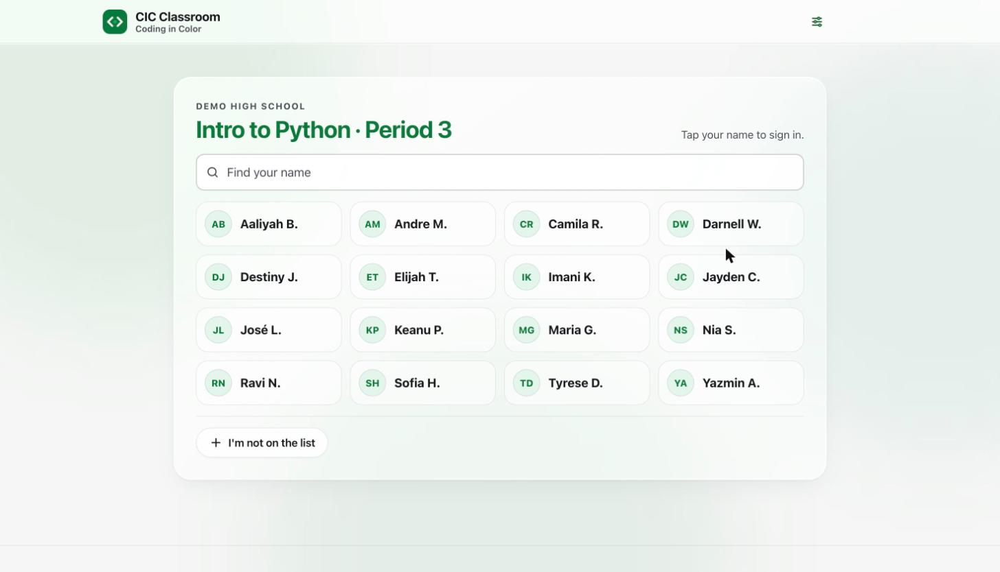
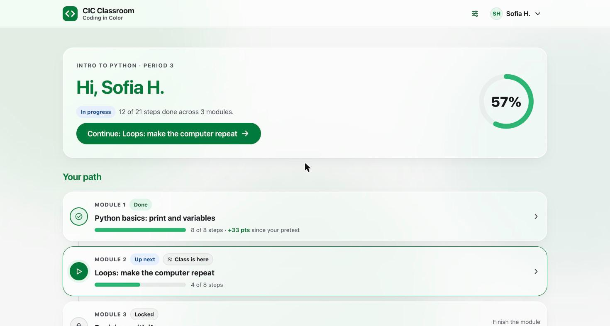
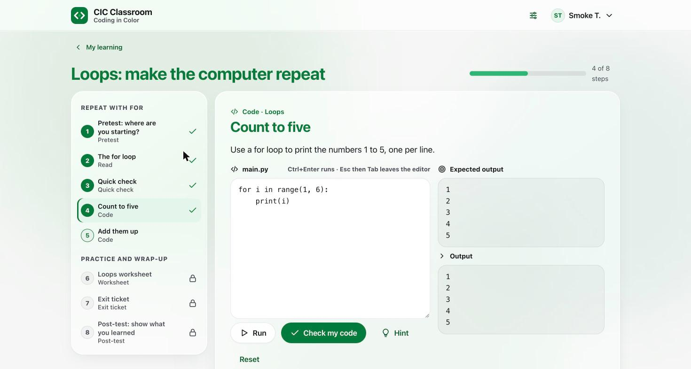

# CIC Classroom: curriculum and student progress for Coding in Color

**Students learn to code at their own pace. Teachers see who needs help today. Coding in Color can prove the learning happened.**

Built by **The Panic Pushers** at [ASU Fall Hackathon 2026 | Phoenix Hackathon for Nonprofits](https://www.ohack.dev/hack/fall-2026) for [Coding in Color](https://www.ohack.dev/nonprofit/YIXYdYCoxIZC08uQ5DL3), a Phoenix nonprofit bringing computer science and AI education to students who don't otherwise get it. Problem statement: [Curriculum & Student Progress Platform (CIC Problem 1)](https://www.ohack.dev/project/d09466fadf1b11f18e63deadc507a848). MIT licensed.

| | |
|---|---|
| **Live demo** | _Vercel link goes here_ |
| **Demo video** | _video link goes here_ |
| **Try it** | Class code **`PHX234`**, any name, PIN **`1234`** (see [Demo logins](#demo-logins)) |

<table><tr>
<td></td>
<td></td>
<td></td>
</tr><tr><td align="center">Join: tap your name, enter a PIN</td><td align="center">My learning: where to pick up</td><td align="center">Python in the browser, CodeHS-style</td></tr></table>

---

## The problem

Coding in Color teaches Arizona high school students (ages 14 to 18) in partner schools, camps and the AI Academy. Today their curriculum lives in slides and printed worksheets, so:

- **Students fall behind** when they miss a class or join late, and nothing shows them where to pick up.
- **Teachers find out who was stuck after the module ends**, not before the next class.
- **CIC can't easily show learning gain** (pretest to post-test) to funders, per class or per concept.
- **Changing a lesson needs a developer**, and every class runs a slightly different version.

## What we built

### For students: join in seconds, no email or password
- **Join like a code.org class:** class code → tap your name → 4-digit PIN. It works on a shared Chromebook or a phone. Late joiners can add themselves when the class allows it and get a PIN shown once.
- **My learning:** a journey map of every module, showing done, up next, *class is here*, catch up or locked, plus the points gained since the pretest.
- **Module player** (inspired by CodeHS): pretest → reading/slides/video → quick checks → worksheet → **Python exercises** → exit ticket → post-test.
- **Python runs in the browser** ([Pyodide](https://pyodide.org) in a Web Worker): no installs, no accounts, and an infinite loop is stopped after 6 seconds. Exercises are checked against expected output and tests.
- **Hints that don't give the answer away:** the author's hints first, then general nudges ("read the last line of the error first").

### For instructors: who needs me today?
- **Today list**, most urgent first: *locked out → stuck → not started → behind*, each with the reason in plain words and a one-click action.
- **Roster** with CIC's own four statuses (**Not started / In progress / Complete / Stuck**) and progress and gain per module.
- **Learning gain per module:** pretest vs post-test, counting only students who took both.
- **Actions:** set the class pace (late joiners start where the class is), reset a PIN (shown once, audited), place a late joiner at a module, and read a student's answers, code and hints.

### For CIC staff: everything is data, not code
- **Curriculum API:** modules → lessons → activities (9 types), each with a draft/publish state and reordering. Activities students have answered can't be deleted, so no progress is lost.
- **Roles are data:** permissions are checked on the server against roles stored in the database (admin, CIC staff, instructor, external reviewer).
- **Learning gain** uses one shared rule set (`server/gain.js`) and is checked against a hand-calculated fixture.
- **Audit log** for publishing, deleting, PIN resets and placements.

### Demo content from CIC's own material
- **Build a Story Generator:** CIC's proposed 5-lesson Python + AI module plus a capstone. The same 8-question pretest and post-test, and a "prompt → run → explain → fix" approach to AI.
- **Data & AI: how machines learn:** from CIC's Module 3 slides (AI vs ML vs deep learning, the data pipeline, cleaning a class snack survey, bias).
- Three starter Python modules: print and variables, loops, and if/else.
- **4 demo classes, 54 students, about 600 submissions,** covering every case a teacher meets. See [`samples/README.md`](samples/README.md).

## Demo logins

| Who | How to sign in | Where to look |
|---|---|---|
| **Student** | Go to `/`, enter class code **`PHX234`**, tap a name, PIN **`1234`** | Try **Destiny J.** (not started) or **Imani K.** (stuck) |
| **Instructor** | `/signin.html` as `instructor@demo.codingincolor.test`, password from `DEMO_STAFF_PASSWORD` | **Classes → Story Lab · Period 5** shows every case |
| **CIC admin** | `/signin.html` as `admin@codingincolor.net`, password from `SEED_PASSWORD` | Sees every class, including the archived one |

Other class codes: **`SPK7QR`** (AI Academy, Data & AI and Story Generator), **`STR9KM`** (closed class: no self-join, one locked-out student). `SUM26X` is archived, so it can't be joined.

> Judges: ask the team in Slack for the demo instructor password. It's never committed.

## Run it locally

You need **Node 20+** and a **Postgres** database (CI uses Postgres 18). A free [Neon](https://neon.tech) project works; so does local Postgres.

```bash
git clone https://github.com/2026-Arizona-Opportunity-Hack/The-Panic-Pushers-CodinginColor.git
cd The-Panic-Pushers-CodinginColor
npm ci
cp .env.example .env          # set DATABASE_URL (owner connection string)
npm run db:setup -- --reset   # creates tables, row-level security, roles, the cic_app user and the first admin
                              #   (writes APP_DATABASE_URL into .env and prints the admin password if SEED_PASSWORD is empty)
npm run db:seed               # demo modules, classes, students and progress (safe to run again)
npm run build                 # copies the Python runtime (Pyodide) into public/pyodide
npm run dev                   # http://localhost:3000  (PORT=4000 npm run dev to change it)
```

| Command | What it does |
|---|---|
| `npm test` | 65 tests: API, permissions, row-level security, grading, learning gain, validation. Database tests need `APP_DATABASE_URL`. |
| `npm run check:headers` | Checks that the security headers in `vercel.json` and the dev server match |
| `npm run check:contrast` | Checks every text and background colour pair meets WCAG AA, in light and dark mode |

CI runs all three on every pull request against a throwaway Postgres, and fails if any test is skipped.

## Deploy (Vercel + Neon)

1. Import this repo in Vercel. The settings come from `vercel.json`: build `npm run build`, output `public`, and one serverless function at `api/index.js`.
2. Set the environment variables: **`APP_DATABASE_URL`** (the restricted `cic_app` connection string). Don't give Vercel the owner `DATABASE_URL`.
3. Run `npm run db:setup -- --reset` and `npm run db:seed` once from your machine against the same Neon database.

Running costs: Vercel Hobby and Neon Free cover a pilot. Nothing else is billed.

## How it works

```
Browser (plain HTML/CSS/JS, no build step)          Vercel function: api/index.js
  ├─ pages: /, /join, /learn, /module,                └─ server/router.js: every route declares who may call it
  │         /signin, /home, /teach, /class                 ├─ auth.js: staff sessions, student PIN sessions, CSRF
  ├─ Pyodide in a Web Worker (student Python)              ├─ routes/: auth, curriculum, student, classes
  └─ fetch /api/* (JSON, same origin)          ───────►    ├─ progress.js: unlocking, status, stuck detection
                                                           └─ gain.js: learning gain rules
                                                                │ withActor(): sets the actor for row-level security
                                                                ▼
                                                     Neon Postgres (db/schema.sql)
```

- **No framework, no bundler.** The pages are plain HTML, CSS and ES modules, so CIC can change a page without learning a toolchain.
- **One API function.** `server/router.js` serves both Vercel and `npm run dev`.

### Security
- **Row-level security is forced** on student data (students, submissions, hints, unlocks). The app connects as a restricted `cic_app` role, and each request sets who is acting, so a student can only read their own rows even if the code had a bug. `test/rls.test.js` checks this.
- **Every route declares its access:** `public`, `staff` with a permission, `student`, or `apikey`. The router enforces it before the handler runs.
- **Answer keys never reach the browser.** Checks, pretests and post-tests are graded on the server. `test/student.test.js` checks this.
- **Passwords and PINs** are hashed with scrypt. Sessions are random tokens stored as SHA-256 hashes, in HttpOnly SameSite cookies, with a CSRF token on every signed-in write. Five wrong attempts lock the account for 15 minutes.
- **Validated input:** every field has a validator, and errors name the field (`server/validate.js`). Media links must be HTTPS on an allow-list of hosts.
- **Strict security headers:** a Content Security Policy with no inline scripts or styles, HSTS, `frame-ancestors 'none'` and nosniff.
- **No secrets in git:** `.env` is ignored. `.env.example` lists every variable.

### Accessibility
- WCAG AA contrast is checked in CI for light and dark mode.
- **Display settings** on every page: light, dark or system theme, three text sizes, high contrast and reduced motion. The operating system's reduced-transparency setting is respected too.
- Everything works with a keyboard, with a skip link and visible focus. The code editor traps Tab for indenting, and Esc then Tab leaves it.
- Screen readers get labelled controls, live regions for results and native `<dialog>` modals. Every page is checked with axe-core.
- Touch targets are at least 44px, with a big PIN pad and name grid for phones and Chromebooks. Nothing scrolls sideways at 360px wide.

## Project layout

```
api/index.js            Vercel entry point
server/                 router, auth, db (withActor, audit), validate, progress, gain, routes/
db/schema.sql           tables, row-level security policies, permission keys
db/demo-*.js            demo modules and classes (loaded by npm run db:seed)
public/                 pages, css/ (tokens, glass, components), js/ui (shared), js/pages (one per page)
samples/                roster CSVs with edge cases, learning-gain fixture, expected results
scripts/                dev server, db setup and seed, build, header and contrast checks
test/                   node:test suites (run against a real database)
```

## Known gaps (honest list)

| Gap | Today | Next step |
|---|---|---|
| Curriculum editor UI | The API is complete and tested; content is loaded with `db:seed` | An outline editor on top of the existing API |
| Roster CSV import | The spec and edge-case files are in `samples/` | Parser plus preview screen, tested against `roster-edge-cases.expected.csv` |
| Code checking | Runs in the student's browser; the server stores the result the browser reports | Re-run tests server-side for graded work |
| AI hints | The hint ladder uses author and built-in hints | Socratic AI hints through the OHack gateway, with no personal data in prompts |
| Admin screens | Roles, schools and cohorts are database rows | CRUD screens and an audit log viewer |
| Funder report and read API | `server/gain.js` computes the numbers | A printable impact report and an aggregate-only API |

## Team

- [Kunal Jadhav](https://github.com/jadhav-kunal)
- [Srujan Rudrapati](https://github.com/SrujanRudrapati)
- [Suraj](https://github.com/suraj991)
- [Yash](https://github.com/Yashsai5)

Work is tracked as [GitHub Issues](https://github.com/2026-Arizona-Opportunity-Hack/The-Panic-Pushers-CodinginColor/issues?q=is%3Aissue), one per task, each closed by the pull request that delivered it.

## Hackathon links

[Team page](https://www.ohack.dev/hack/fall-2026/team/cab7b7f2e06311f18facdeadfb009123) · [Team Dashboard](https://www.ohack.dev/hack/fall-2026/manageteam) · Slack: [#panic-pushers](https://opportunity-hack.slack.com/app_redirect?channel=panic-pushers), [#npo-coding-in-color](https://opportunity-hack.slack.com/app_redirect?channel=npo-coding-in-color) · [Judging criteria](https://www.ohack.dev/hackathon-judging-criteria)
